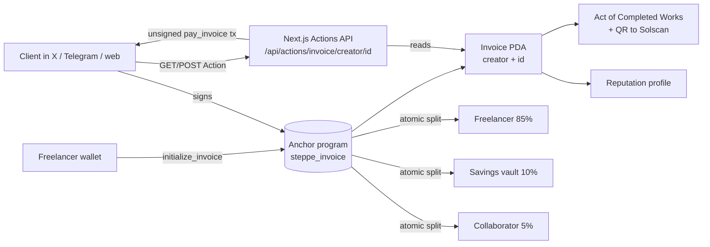

# 🏹 SteppeInvoice

**Invoice the world. Get paid in one click.** Solana invoices with instant on-chain auto-split, shareable Blinks, and an official Kazakhstan *Акт выполненных работ* sealed with an on-chain QR.

Built for the Superteam Kazakhstan track of the Colosseum Crypto World's Fair Hackathon.

## The problem

Freelancers in Kazakhstan and Central Asia selling to clients abroad face slow, expensive SWIFT transfers, cards that don't work across borders, and platforms (Upwork, Fiverr) that own their reputation. On top of that, local accounting and tax filing still expect a formal *Акт выполненных работ* tied to every payment.

## The solution

1. **Create** an invoice on Solana: amount, title, and an auto-split (savings/tax vault, optional collaborator).
2. **Share a Blink**: one link that your client can pay from X, Telegram, or any Solana Actions client.
3. **Get paid atomically**: the smart contract splits the payment in the same transaction. No custody, no waiting.
4. **Close the books**: one click generates a printable Act of Completed Works (KZT equivalent + QR to the Solscan settlement transaction).
5. **Portable reputation**: a public profile computed from your on-chain invoices.

## Architecture



| Part | Where |
| --- | --- |
| Anchor program | `programs/steppe_invoice/src/lib.rs` |
| Program tests (9) | `tests/steppe_invoice.ts` |
| Web app (Next.js) | `app/` |
| Blink / Actions API | `app/app/api/actions/invoice/[creator]/[id]/route.ts`, `app/app/actions.json/route.ts` |
| Act of Works | `app/app/invoice/[creator]/[id]/act/page.tsx` |
| Reputation profile | `app/app/profile/[wallet]/page.tsx` |

### Smart contract

Invoice PDA seeds: `["invoice", creator, invoice_id (u64 LE)]`.

- `initialize_invoice` validates `vault_bps + collaborator_bps <= 10000`, title ≤ 64 bytes, amount > 0, and that a collaborator share has a collaborator wallet.
- `pay_invoice` computes shares with `checked_mul` / `checked_div`, transfers to vault, collaborator and creator via the System Program in the same transaction, sets `is_paid`, `payer`, `paid_at`, and emits `InvoicePaidEvent`. The creator receives the remainder, so rounding dust is never lost. A paid invoice cannot be paid again.
- `cancel_invoice` closes an **unpaid** invoice and refunds rent to the creator; only the creator can call it.

## Run it

Prerequisites: Rust, Solana CLI, Anchor 1.2.1, Node 22. (On Windows use WSL Ubuntu; `scripts/` contains the setup helpers.)

```bash
# 1. Program tests (local validator)
anchor build
anchor test --validator legacy        # 9 passing

# 2. Web app
cd app
cp .env.example .env.local            # set NEXT_PUBLIC_PROGRAM_ID, NEXT_PUBLIC_APP_URL
npm install --legacy-peer-deps
npm run dev                           # http://localhost:3000
npm run build                         # production build
npx vitest run                        # split math unit tests

# 3. End-to-end scripts (any cluster)
KEYPAIR=~/.config/solana/id.json RPC=https://api.devnet.solana.com \
  NEXT_PUBLIC_PROGRAM_ID=<id> npx tsx scripts/smoke.ts
KEYPAIR=... RPC=... APP=http://localhost:3000 NEXT_PUBLIC_PROGRAM_ID=<id> npx tsx scripts/blink-e2e.ts
```

### Deploy to Devnet

```bash
solana config set --url devnet
solana airdrop 2          # or https://faucet.solana.com
anchor deploy --provider.cluster devnet
```

Program ID (declared in the program): `7ze4Utjmn73v42terYZMTFVGCt2ygVu9u85US89uNGJm`

> Devnet deployment status and sample transactions are listed in [`docs/DEVNET.md`](docs/DEVNET.md).

## Blinks

- `GET /actions.json` (and `/api/actions.json`): routing rules for `/pay/*/*` → `/api/actions/invoice/*/*`.
- `GET /api/actions/invoice/:creator/:id`: Action metadata (dynamic banner, title, auto-split description, `Pay Invoice` label).
- `POST /api/actions/invoice/:creator/:id` with `{ "account": "<payer>" }`: returns a base64 `pay_invoice` transaction + message.

Blinks unfurl inside X only from a public HTTPS domain registered with Dialect; every invoice also works through `https://dial.to/?action=solana-action:<action-url>`.

## Scope and honesty

- **SOL only** on Devnet in this submission. SPL USDC is the first roadmap item.
- The **savings vault** is a configurable wallet address. Routing it into yield vaults (Kamino / Jito / Lulo) is roadmap, not implemented; the UI says so.
- Invoice description and client name are kept off-chain (link parameters / Act form); only the title is stored on-chain.
- The KZT equivalent on the Act is an informational rate (CoinGecko SOL/USD × open.er-api USD/KZT) at generation time, not an official NBK rate. The Act is a helper document; check requirements with your accountant.
- The program has tests but **has not been independently audited**.

## Roadmap

SPL USDC, yield-vault routing, per-invoice client details on-chain via hashed metadata, recurring invoices, Kaspi/KZT off-ramp partners, e-sign of the Act.
